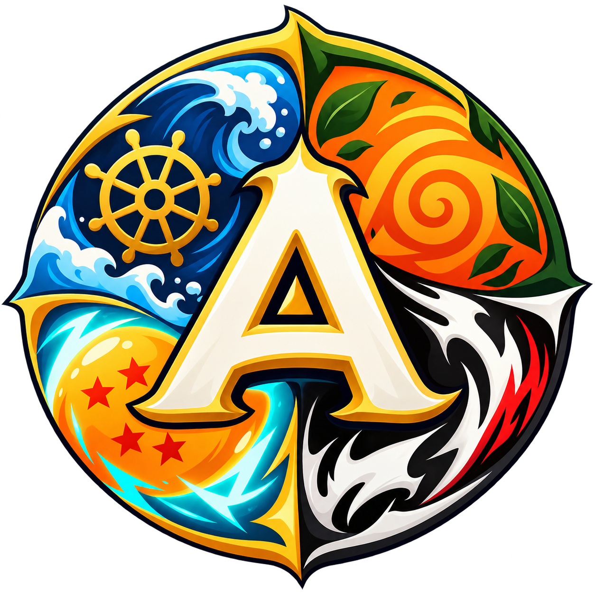
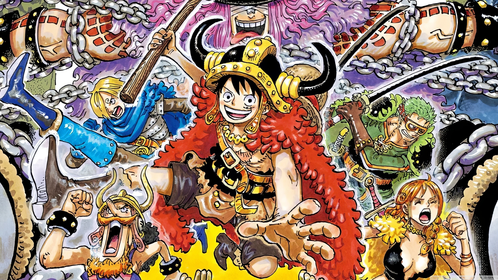
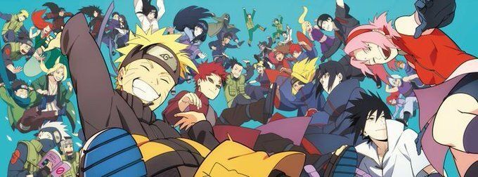
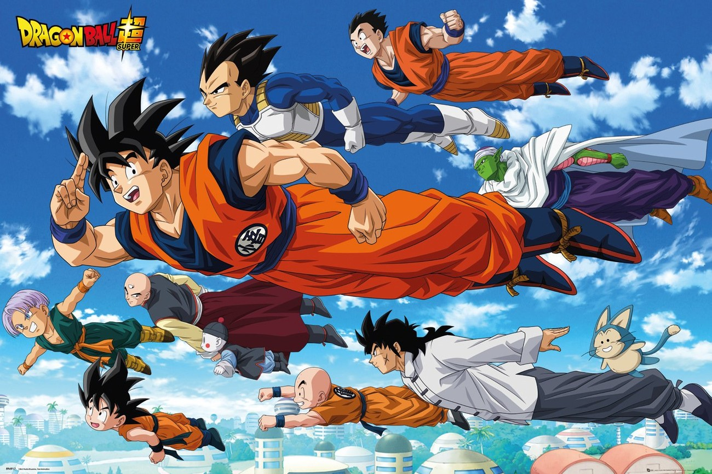
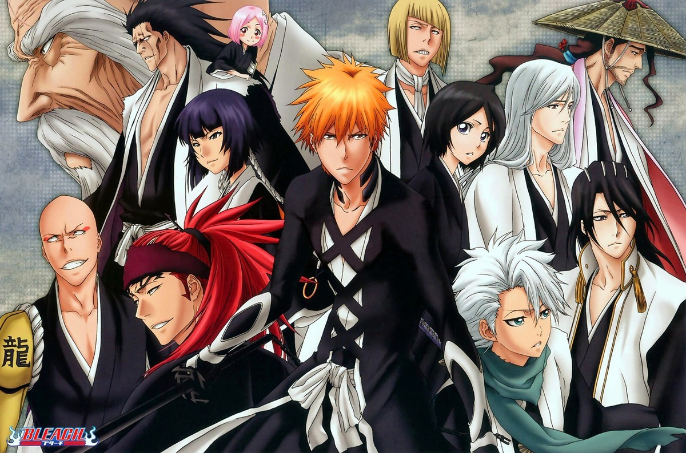

<div align="center">



# ANIMEDLE

### Quattro universi. Un personaggio segreto. Infinite sfide.

**Un gioco di deduzione dedicato agli anime, ispirato ai giochi in stile _Dle_.**  
Scegli il tuo universo, indovina il personaggio misterioso e usa gli indizi per arrivare alla soluzione.

<p>
  <a href="https://gisolfi02.github.io/Animedle/"></a>
  <a href="https://github.com/gisolfi02/Animedle"></a>
</p>

<p>
  
  
  
  
</p>

**[🌐 Apri Animedle](https://gisolfi02.github.io/Animedle/)**

</div>

---

## 🌌 Esplora i quattro universi

Ogni gioco ha una propria identità grafica, un insieme di personaggi e categorie di indizi differenti.

<table>
  <tr>
    <td align="center" width="50%">
      <a href="https://gisolfi02.github.io/Animedle/onepiece/"></a><br />
      <strong>🏴‍☠️ OnePiecedle</strong><br />
      <sub>Grand Line · Mappa del tesoro</sub><br /><br />
      Ciurma, Frutti del Diavolo, Haki, taglie e molto altro.<br /><br />
      <a href="https://gisolfi02.github.io/Animedle/onepiece/">Gioca a OnePiecedle</a>
    </td>
    <td align="center" width="50%">
      <a href="https://gisolfi02.github.io/Animedle/naruto/"></a><br />
      <strong>🍃 Narutodle</strong><br />
      <sub>Pergamena dello Shinobi</sub><br /><br />
      Villaggi, tecniche ninja, Kekkei Genkai e nature del chakra.<br /><br />
      <a href="https://gisolfi02.github.io/Animedle/naruto/">Gioca a Narutodle</a>
    </td>
  </tr>
  <tr>
    <td align="center" width="50%">
      <a href="https://gisolfi02.github.io/Animedle/dragonball/"></a><br />
      <strong>🐉 Dragonballdle</strong><br />
      <sub>Dragon Radar · Capsule Edition</sub><br /><br />
      Capelli, razze, provenienze, saghe e serie.<br /><br />
      <a href="https://gisolfi02.github.io/Animedle/dragonball/">Gioca a Dragonballdle</a>
    </td>
    <td align="center" width="50%">
      <a href="https://gisolfi02.github.io/Animedle/bleach/"></a><br />
      <strong>⚔️ Bleachdle</strong><br />
      <sub>Bankai · Monochrome Edition</sub><br /><br />
      Razze, professioni, affiliazioni e archi narrativi.<br /><br />
      <a href="https://gisolfi02.github.io/Animedle/bleach/">Gioca a Bleachdle</a>
    </td>
  </tr>
</table>

## 🎮 Come si gioca

1. **Scegli un anime** dalla schermata iniziale.
2. **Cerca un personaggio** digitandone il nome nella barra di ricerca e selezionandolo dai suggerimenti.
3. **Leggi gli indizi:** ogni tentativo aggiunge una riga con gli attributi del personaggio scelto, confrontati con quelli della risposta segreta.
4. **Restringi le possibilità** usando colori, corrispondenze parziali e frecce direzionali.
5. **Indovina il personaggio** oppure rivela la soluzione, poi avvia una nuova partita quando vuoi.

### Come interpretare i colori

| Indicatore | Significato                                                                                                                              |
| :--------: | ---------------------------------------------------------------------------------------------------------------------------------------- |
|     🟩     | **Corretto** - l'attributo coincide con quello del personaggio segreto.                                                                  |
|     🟨     | **Parziale** - esiste una corrispondenza parziale, nelle categorie che la prevedono.                                                     |
|     🟥     | **Errato** - l'attributo non corrisponde.                                                                                                |
|     ⬜     | **Sconosciuto / non disponibile** - il dato non permette un confronto completo, quando previsto.                                         |
|  ⬆️ / ⬇️   | **Più alto / più basso** - il valore cercato è maggiore o minore (per esempio altezza, taglia o ordine di debutto, a seconda del gioco). |

<details>
<summary><strong>📋 Quali attributi vengono confrontati?</strong></summary>

| Gioco             | Attributi                                                                                                               |
| ----------------- | ----------------------------------------------------------------------------------------------------------------------- |
| **OnePiecedle**   | Personaggio, genere, affiliazione, Frutto del Diavolo, Haki, ultima taglia, altezza, provenienza, primo arco narrativo. |
| **Narutodle**     | Personaggio, genere, affiliazioni, tipi di jutsu, Kekkei Genkai, nature del chakra, attributi e arco di debutto.        |
| **Dragonballdle** | Personaggio, genere, capelli, origine/universo, razza, saga e serie.                                                    |
| **Bleachdle**     | Personaggio, genere, altezza, razza, professione, luogo, affiliazione e primo arco narrativo.                           |

</details>

## ✨ Funzionalità

- 🎲 **Partite rigiocabili:** un nuovo personaggio segreto per ogni partita.
- 🔎 **Ricerca con suggerimenti:** trova rapidamente i personaggi e selezionali dall'elenco.
- 🧩 **Indizi visivi:** colori, confronti e frecce aiutano a dedurre la risposta.
- 🎴 **Rivelazione progressiva:** gli indizi compaiono con un'animazione sequenziale.
- 🎨 **Quattro temi grafici:** un'interfaccia personalizzata per ciascun anime.
- 📱 **Layout responsive:** giocabile da desktop, tablet e smartphone; la tabella può scorrere orizzontalmente sugli schermi piccoli.
- 🔊 **Atmosfera sonora opzionale:** dove configurata, puoi attivare o disattivare il sottofondo ambientale durante la partita.
- ⚡ **Nessun backend richiesto:** il gioco funziona nel browser usando HTML, CSS, JavaScript e file JSON.

## 🛠️ Tecnologie

| Tecnologia               | Utilizzo                                                           |
| ------------------------ | ------------------------------------------------------------------ |
| **HTML5**                | Struttura delle pagine e interfaccia dei giochi.                   |
| **CSS3**                 | Temi, responsive design e animazioni degli indizi.                 |
| **JavaScript (Vanilla)** | Logica dei tentativi, ricerca, confronti e gestione delle partite. |
| **JSON**                 | Dataset dei personaggi, mantenuti separati dalla logica di gioco.  |
| **Font Awesome**         | Icone dei controlli e dell'interfaccia.                            |
| **GitHub Pages**         | Pubblicazione del sito statico.                                    |

## 📁 Organizzazione del progetto

La struttura principale è organizzata per anime, separando l'interfaccia, la logica e i dati:

```text
Animedle/
├── index.html                 # Home / selezione dei giochi
├── onepiece/
│   ├── index.html
│   └── characters.json
├── naruto/
│   ├── index.html
│   └── characters.json
├── dragonball/
│   ├── index.html
│   └── characters.json
├── bleach/
│   ├── index.html
│   └── characters.json
├── js/
│   ├── onepiece.js
│   ├── naruto.js
│   ├── dragonball.js
│   ├── bleach.js
│   └── ambient.js           # Gestione audio condivisa, se abilitata
├── styles/                      # Fogli di stile dei giochi
├── images/                   # Banner e icone del sito
└── audio/                    # Sottofondi ambientali, se presenti
```

## 🚀 Avvio in locale

**1. Clona la repository:**

```bash
git clone https://github.com/gisolfi02/Animedle.git
cd Animedle
```

**2. Avvia un semplice server HTTP:**

```bash
python -m http.server 8000
```

**3. Apri il browser:**

```text
http://localhost:8000/
```

> **Importante:** non aprire direttamente i file HTML con `file://`. I giochi caricano i personaggi tramite `fetch()` richiedono normalmente un server HTTP, anche in locale. In alternativa puoi usare **Live Server** su Visual Studio Code.

## 🧭 Personalizzazione

- **Personaggi:** modifica il file `characters.json` del gioco interessato, mantenendo i campi utilizzati dal relativo JavaScript.
- **Aspetto:** modifica il CSS del gioco per personalizzarne colori, elementi e animazioni.
- **Sottofondi:** inserisci audio con licenza idonea e collega la traccia nell'HTML corrispondente; la gestione del pulsante può essere condivisa tramite `js/ambient.js`.

Il progetto è pensato per essere aggiornato per singolo universo, senza dover modificare la logica degli altri giochi.

## 💬 Segnalazioni e suggerimenti

Hai notato un dato errato, un'immagine non disponibile o un problema nell'interfaccia? Puoi segnalarlo aprendo una **[GitHub Issue](https://github.com/gisolfi02/Animedle/issues)**, specificando il gioco, il personaggio e il comportamento osservato.

## ⚖️ Disclaimer e diritti

Animedle è un **progetto fan-made non ufficiale**, realizzato per passione e intrattenimento. Non è affiliato né approvato dai creatori, dagli editori o dagli altri titolari dei diritti delle opere rappresentate.

_One Piece_, _Naruto_, _Dragon Ball_ e _Bleach_, con i rispettivi personaggi, nomi, immagini e altri elementi protetti, appartengono ai relativi aventi diritto. La presenza di materiali nel progetto non implica un'autorizzazione al loro riutilizzo.

---

<div align="center">

**Fatto con passione per gli anime.** ❤️

**[🎮 GIOCA AD ANIMEDLE](https://gisolfi02.github.io/Animedle/)**

</div>
